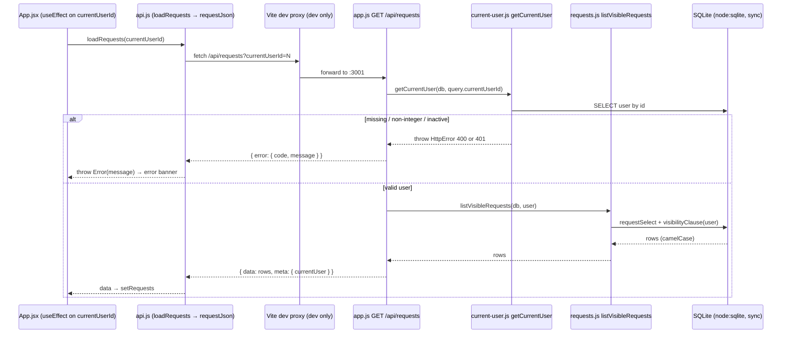

# Internal Request Hub — Architecture

**Audience:** engineers and technical reviewers.
**Status:** Accepted (31 Oct 2026).
**Companion to:** [`domain.md`](domain.md), which covers business rules. This document covers how the code implements them.
**Verified against the code on:** 31 Oct 2026, updated for request comments and for approve/reject decisions (`npm test`: 61 server + 19 client tests passing; `npm run lint`: clean; `npm run build`: succeeds).

## How to read this document

Each claim carries one label, the same convention as the domain guide:

- **Confirmed**: read directly in the code or config cited, or observed by running a command.
- **Inference**: a reasonable reading of intent or behavior that the code doesn't state outright, or that wasn't exercised.
- **Open question**: a gap or ambiguity that needs a decision.

Evidence is given as `path` → `function` (line). Sections 1–9 describe the **current** architecture. Recommendations are kept separately in section 10.

---

## 1. Stack

| Layer | Technology | Evidence | Label |
|---|---|---|---|
| UI | React 19, rendered under `StrictMode` | `client/package.json`; `client/src/main.jsx` | Confirmed |
| Dev server / bundler | Vite 7 with `@vitejs/plugin-react` | `client/vite.config.js` | Confirmed |
| API | Express 5 with `cors` and `express.json()` | `server/package.json`; `server/src/app.js` → `createApp` (20–23) | Confirmed |
| Database | SQLite through Node's built-in `node:sqlite` (`DatabaseSync`, a synchronous API). No ORM, no driver package. | `server/src/db.js` (3, 14) | Confirmed |
| Server tests | Node's built-in test runner (`node --test`) with `node:assert/strict` | `server/package.json`; `server/test/app.test.js`; `server/test/comments-http.test.js` | Confirmed |
| Client tests | Vitest + jsdom + Testing Library | `client/vite.config.js` (`test` block); `client/src/test-setup.js` | Confirmed |
| Lint | ESLint 9 flat config in each workspace | `server/eslint.config.js`; `client/eslint.config.js` | Confirmed |
| Module system | ES modules everywhere (`"type": "module"`) | both workspace `package.json` files | Confirmed |
| Language | Plain JavaScript/JSX. No TypeScript, no type-checking step. | file extensions; no `tsconfig` | Confirmed |

- **Confirmed:** The root `package.json` declares `"engines": { "node": ">=22" }`, but the README requires **Node 22.13 or later**.
- **Inference:** The stricter README requirement comes from `node:sqlite`, which is only usable without an experimental flag from 22.13. Running on 22.0–22.12 would fail at startup, even though `engines` allows it. (Local verification ran on Node 24.21.)
- **Confirmed:** No state-management, routing or data-fetching library is used. The client uses React state plus `fetch` only (`client/package.json`).

## 2. Repository structure

```
package.json            npm workspaces root ("client", "server"); orchestration scripts
client/                 React SPA (Vite)
  index.html            mounts #root, loads src/main.jsx
  src/main.jsx          createRoot + StrictMode
  src/App.jsx           all application state and actions
  src/api.js            fetch wrapper + one function per endpoint
  src/components/       presentational components
server/
  src/index.js          process entry: env, DB, listen, shutdown
  src/app.js            createApp({ db }): routes, static serving, error middleware
  src/current-user.js   resolves the simulated identity
  src/requests.js       visibility, permission and status-transition rules + SQL
  src/comments.js       request comment rules + SQL (reuses getVisibleRequest)
  src/http-errors.js    HttpError class + JSON error envelope
  src/db.js             connection, schema creation, seed
  src/reset-db.js       deletes and recreates the local DB file
  test/app.test.js      server unit tests (domain functions, in-memory DB)
  test/comments-http.test.js  HTTP-level tests for the comment routes
  test/decisions-http.test.js HTTP-level tests for the approve/reject routes
  data/                 runtime DB location (gitignored)
.github/workflows/ci.yml
```

- **Confirmed:** It's an npm workspaces monorepo. Root scripts delegate to each workspace with `--workspace=` (root `package.json`).
- **Confirmed:** `client/dist/` and `server/data/*.db*` are gitignored (`.gitignore`).
- **Confirmed:** The client and server share no code. The shape of the API data is an implicit contract with no shared types or schema.

## 3. Request flow: React → Express → SQLite

### 3.1 Trace: loading the request list

What happens when the selected user changes, including on first load:

1. **Confirmed:** `client/src/App.jsx` → the first `useEffect` (30) calls `loadUsers()` once and sets `currentUserId` to the first user returned.
2. **Confirmed:** `client/src/App.jsx` → the second `useEffect` (39), keyed on `currentUserId`, sets loading, clears the error, the selected request and its comments, then calls `loadRequests(currentUserId)`.
3. **Confirmed:** `client/src/api.js` → `loadRequests` (18) calls `requestJson("/api/requests?currentUserId=<id>")`. The URL is **relative**, so it goes to whatever origin served the page.
4. **Confirmed:** `client/src/api.js` → `requestJson` (1) runs `fetch`, parses JSON (falling back to `null` on parse failure), and **throws `new Error(body.error.message)`** on a non-2xx response. On success it returns the parsed body, and `loadRequests` returns `.data`.
5. **Confirmed (dev only):** Vite forwards `/api` to `http://localhost:3001` (`client/vite.config.js` → `server.proxy`).
6. **Confirmed:** `server/src/app.js` → `GET /api/requests` (46) calls `getCurrentUser(db, request.query.currentUserId)`.
7. **Confirmed:** `server/src/current-user.js` → `getCurrentUser` (3) runs `Number()` on the raw value, throws `HttpError(400, "CURRENT_USER_REQUIRED")` if the result isn't an integer, looks up the user by id, and throws `HttpError(401, "INVALID_CURRENT_USER")` if the user is missing or inactive. Otherwise it returns `{ id, name, email, role, active: boolean }`.
8. **Confirmed:** `server/src/requests.js` → `listVisibleRequests` (31) builds a `WHERE` clause from `visibilityClause(user)` (153): `1 = 1` for admin, `r.assigned_reviewer_id = ?` for reviewer, otherwise `r.requester_id = ?`. It runs the shared `requestSelect` SQL (4) ordered by `created_at DESC, id DESC`.
9. **Confirmed:** `requestSelect` joins `requests` with `categories`, the requester (`users`), an optional reviewer (`LEFT JOIN users`), and an optional decision (`LEFT JOIN request_decisions` plus `LEFT JOIN users decider`). It aliases the columns to camelCase (`requesterId`, `assignedReviewerName`, `decidedByName`, `decidedAt`, …). The client renders these field names directly. The decision fields are null when there is no decision.
10. **Confirmed:** The route responds `{ data: rows, meta: { currentUser } }`. The client **ignores `meta`** (no reference in `client/src`).
11. **Confirmed:** On error, the route's `try/catch` calls `next(error)`. The error middleware in `server/src/app.js` (116) maps it to a status and the `{ error: { code, message } }` envelope from `server/src/http-errors.js` → `errorResponse`.
12. **Confirmed:** Back in `App.jsx`, the rows go into `requests` state, or the error message into `error` state, which renders as a `role="alert"` banner. `finally` clears loading.



### 3.2 Detail and mutation calls (differences only)

- **Confirmed:** Request detail: `App.jsx` → `openRequest` (51) → `api.js` → `loadRequest` (22) → `GET /api/requests/:id` (`app.js` 55) → `requests.js` → `getVisibleRequest` (40). It validates that the id is an integer (400), loads the row (404), then applies the role visibility rule **in JavaScript** through `canViewRequest` (58), giving 403 "You cannot view this request.".
- **Confirmed:** `openRequest` loads the request and its comments together (`Promise.all` of `loadRequest` and `loadComments`, `api.js` 47), and sets both.
- **Confirmed:** Comments are `GET` and `POST /api/requests/:id/comments` (`app.js` 91, 100). They call `listComments` (16) and `addComment` (25) in `server/src/comments.js`.
  - Both call `getVisibleRequest` first, so comment access is exactly request-detail access.
  - `addComment` trims the text, refuses an empty result with 400 `COMMENT_TEXT_REQUIRED`, inserts one row and returns it.
  - POST responds **201**. It is the only route that does; every other route responds 200.
  - The client appends the returned comment without refetching (`App.jsx` → `addCommentToSelectedRequest`, 65).
- **Confirmed:** Cancel, approve and reject are `POST /api/requests/:id/{cancel|approve|reject}` (`app.js` 64, 73, 82). They call `cancelRequest` (128), `approveRequest` (91) and `rejectRequest` (103) in `requests.js`. Approve and reject share `loadDecidableRequest` (64). Only reject reads a body (`{ comment }`).
- **Confirmed:** Approve and reject run the status `UPDATE` and `recordDecision` (122, an `INSERT INTO request_decisions`) inside `transaction` (`db.js` 120), using one timestamp for `updated_at` and `decided_at`. Either both are saved or neither is.
- **Confirmed:** Cancel runs a single `UPDATE`. Approve and reject run an `UPDATE` plus an `INSERT INTO request_decisions` in one transaction. Each mutation then re-reads the row through `requestSelect` to return it. `App.jsx` then refetches the whole list (`cancelSelectedRequest`, `approveSelectedRequest`, `rejectSelectedRequest`).
- **Confirmed:** `GET /api/categories` exists (`app.js` 41), but nothing in `client/src` calls it.

## 4. Responsibility boundaries

| Module | Owns | Does not own | Label |
|---|---|---|---|
| `server/src/index.js` | Reading `PORT` and `DB_FILE`, creating the DB, starting `listen`, SIGINT/SIGTERM shutdown (closes the server, then the DB) | Routes, rules | Confirmed |
| `server/src/app.js` → `createApp` | HTTP wiring, resolving identity per request, response envelopes, static serving, error mapping | Business rules (delegates them to `requests.js` and `comments.js`) | Confirmed |
| `server/src/requests.js` | All request visibility, permission and status-transition rules, plus their SQL | HTTP concerns (it throws `HttpError` and never touches `req`/`res`) | Confirmed |
| `server/src/comments.js` | Comment validation, listing order and insert, plus their SQL | Access rules: it delegates them to `getVisibleRequest` in `requests.js`. It never writes to `requests`. | Confirmed |
| `server/src/current-user.js` | Turning a raw id into an active user, or an error | Role-specific rules | Confirmed |
| `server/src/db.js` | Connection pragmas, schema, seed | Queries for features | Confirmed |
| `client/src/api.js` | URLs, HTTP methods, unwrapping `.data`, turning error envelopes into thrown `Error`s | State | Confirmed |
| `client/src/App.jsx` | All state (users, current user, list, selection, the selection's comments, loading, error) and every action | Rendering details (passed to components as props/callbacks) | Confirmed |
| `client/src/components/*` | Presentation. `RequestDetails` also decides which action buttons to show, and holds the comment draft text. | Data fetching | Confirmed |

- **Confirmed:** `/api/users` and `/api/categories` put their SQL inline in `app.js` (29, 41) instead of in a domain module. That breaks the pattern `requests.js` follows.
- **Inference:** `createApp({ db })` takes the database as a parameter so the app can be built against a different DB, such as an in-memory one. Today, only the domain functions are tested that way (see section 8).

## 5. Identity and access enforcement

- **Confirmed:** Identity is a plain `currentUserId` **query-string parameter**, sent on every request call including POSTs (`client/src/api.js`). There is no session, cookie, token or header-based auth anywhere in `server/src`.
- **Confirmed:** The server trusts that parameter completely. Any HTTP client can act as any active user by changing the number. The README describes this as "not production authentication".
- **Confirmed:** `GET /api/users` and `GET /api/categories` need **no** identity. `/api/users` returns the names, emails and roles of every active user (`app.js` 29).
- **Confirmed:** Enforcement is server-side, in `requests.js`:
  - List visibility: in SQL, `visibilityClause` (153).
  - Detail visibility: in JavaScript, `canViewRequest` (58), used by `getVisibleRequest` (40) and `loadDecidableRequest` (64). The same three-way role rule is written a second time, once in SQL and once in JavaScript.
  - Cancel: `requesterId === user.id` and status `Submitted` (`cancelRequest`, 128). **No role check.**
  - Approve/reject (`loadDecidableRequest`, 64):
    1. id format (400)
    2. missing **or not viewable by the user** → 404 "Request not found.", so non-viewers learn nothing
    3. `assignedReviewerId === user.id` **and** `user.role === "reviewer"` **and** `requesterId !== user.id`, otherwise 403 "You cannot decide this request."
    4. status `Submitted` (409)
    5. for reject, a non-empty comment (400)
  - Comments (list and add): `getVisibleRequest` only (`comments.js`), so they follow the detail rule, not the list SQL. **No status check**: comments are allowed at every status.
  - Order of checks for cancel: id format (400) → existence (404) → permission (403) → status (409). For approve/reject, see above: a user who can't view the request gets 404, not 403. Adding a comment checks id → existence → permission → text (400).
  - A comment's author is always the resolved current user. The client never sends an author.
- **Confirmed:** The client hides buttons with matching conditions in `client/src/components/RequestDetails.jsx`. That is UX only.
  - Cancel: `status === "Submitted"` and `requesterId === currentUserId`.
  - Approve/Reject: `status === "Submitted"`, `assignedReviewerId === currentUserId`, `currentUserRole === "reviewer"` and `requesterId !== currentUserId`. The server re-checks every action. The comments section is shown for any opened request, because being able to open it already proves the user can view it.
- **Open question:** The visibility rule is written twice (SQL and JavaScript). Nothing forces the two copies to stay in sync except the tests.
- **Open question:** Cancel checks ownership rather than role, so any user who happens to be the requester could cancel, whatever their role. The seed data never sets this up (see domain guide, section 6). Approve/reject now check the role as well.
- **Confirmed:** `errorResponse` (`http-errors.js` 9) returns `error.message` for **any** error, including unexpected ones (status 500).
- **Inference:** Internal error text, such as SQLite messages, could therefore reach the browser.

## 6. Database lifecycle

- **Confirmed:** There is one synchronous `DatabaseSync` connection per process. It is created once at startup in `server/src/index.js` (5) and passed into `createApp`.
- **Confirmed:** The file path is `DB_FILE` or the default `server/data/request-hub.db` (`db.js` → `defaultDatabasePath`). The directory is created if missing. The value `":memory:"` is supported, and the directory step is skipped for it.
- **Confirmed:** Pragmas: `foreign_keys = ON` always, and `journal_mode = WAL` for file databases (`db.js` 15–16).
- **Confirmed:** Schema "migration" is `CREATE TABLE/INDEX IF NOT EXISTS`, run on **every** start (`db.js` → `migrate`, 22). There is no version table and no way to alter an existing table. A schema change won't reach an existing file unless it is reset.
- **Confirmed:** The database enforces the allowed values of role, priority, status and the active flag with `CHECK` constraints. It enforces references with foreign keys (`db.js` → `migrate`).
- **Confirmed:** `migrate` also creates `request_comments` (`id`, `request_id` → `requests`, `author_id` → `users`, `body`, `created_at`), with an index on `(request_id, created_at, id)`.
  - The table was added as an additive `IF NOT EXISTS`, so existing local databases gained it on the next start without a reset. This was observed on the development database on 31 Oct 2026.
  - No comment rows are seeded.
- **Confirmed:** `migrate` also creates `request_decisions` (`request_id` primary key → `requests`, `decided_by_id` → `users`, `decided_at`): at most one decision per request.
  - It's an additive table, so existing local databases gained it on the next start without a reset. This was observed on the development database on 31 Oct 2026.
  - No decision rows are seeded, so the seeded 102 and 104 show "Not recorded".
- **Confirmed:** Seeding (`db.js` → `seed`, 74) runs only when `users` is empty. It inserts 6 users, 4 categories and 5 requests with fixed ids, each group in its own `BEGIN`/`COMMIT` (`transaction`, 120, exported and also used by approve/reject).
- **Confirmed:** Cancel is a single `UPDATE` without an explicit transaction. Approve and reject write the `UPDATE` plus the decision `INSERT` in one transaction. Each handler reads, checks, then writes. `addComment` is a single `INSERT` into `request_comments` and never updates `requests`, so a comment doesn't change the request's `updated_at`.
- **Inference:** Because `DatabaseSync` and every handler are fully synchronous, two requests can't interleave inside one Node process between the check and the write. Running several processes against one file would lose that guarantee.
- **Confirmed:** `npm run db:reset` (`server/src/reset-db.js`) deletes the `.db`, `-shm` and `-wal` files at the **default** path and recreates the database. It ignores `DB_FILE`.
- **Open question:** What happens if `db:reset` runs while the server holds the file open? On Windows, deleting a locked file may fail. This hasn't been tested.
- **Confirmed:** Data persists between restarts. Nothing backs up or exports it.

## 7. Development versus production serving

| | Development (`npm run dev`) | Production-style (`npm run build` then `npm start`) |
|---|---|---|
| Processes | Two, run by `concurrently`: `node --watch src/index.js` (API, :3001) and `vite` (:5173) | One: `node src/index.js` (:3001, or `PORT`) |
| Where the UI comes from | Vite dev server with hot module reload | Express `express.static(client/dist)` plus a catch-all `GET /{*path}` that returns `index.html` |
| How `/api` is reached | Vite proxy, :5173 → :3001 | Same origin |
| Evidence | root `package.json`; `server/package.json`; `client/vite.config.js` | `server/src/app.js` (18, 109–114) |

- **Confirmed:** Static serving is switched on only if `client/dist` exists **when `createApp` runs** (`fs.existsSync`, `app.js` 109). Building after the server has started requires a restart.
- **Inference:** The API also serves the SPA when `client/dist` exists during `npm run dev`. That happens if you ran a build earlier, so :3001 may show a stale UI.
- **Inference:** In production mode, an unknown `GET /api/...` path matches the catch-all and returns `index.html` with status 200, not a JSON 404. Without `client/dist`, Express's default HTML 404 applies instead. (Read from the code, not exercised.)
- **Confirmed:** The Vite proxy target is hard-coded to `http://localhost:3001`. Changing `PORT` breaks the dev proxy.
- **Confirmed:** `cors()` is enabled for all origins with default options (`app.js` 22).
- **Inference:** Neither mode needs CORS, because both are same-origin from the browser's point of view.
- **Confirmed:** `.vscode/launch.json` points Chrome at `http://localhost:8080`, a port neither mode uses.
- **Open question:** There is no deployment configuration (no Dockerfile, process manager or hosting config) in the repo. How production is meant to run hasn't been defined.

## 8. Verification

| Command | What it actually runs | Label |
|---|---|---|
| `npm test` | `node --test` in `server/` (auto-discovers `test/*.test.js`: `app.test.js`, `comments-http.test.js` and `decisions-http.test.js`), then `vitest run` in `client/`. Server first; the client doesn't run if the server fails. | Confirmed (run: 61 + 19 passing) |
| `npm run lint` | `eslint src test` (server), then `eslint src` (client) | Confirmed (run: clean) |
| `npm run build` | `vite build` → `client/dist` | Confirmed (run: succeeds) |
| `npm start` + `GET /api/health` | Serves API + built client; health returns `{ "status": "ok" }` | Confirmed (from code, `app.js` 25; observed on the dev server) |
| CI | On `pull_request` and push to `main`: Node 22 on ubuntu, `npm ci` → `lint` → `test` → `build` | Confirmed (`.github/workflows/ci.yml`) |

Single tests:

```bash
cd server && node --test --test-name-pattern="cancel" test/app.test.js
cd client && npx vitest run src/components/RequestDetails.test.jsx
```

What the tests cover, and what they don't:

- **Confirmed:** `server/test/app.test.js` calls the **domain functions directly** (`getCurrentUser`, `listVisibleRequests`, `getVisibleRequest`, `cancelRequest`, `approveRequest`, `rejectRequest`, `listComments`, `addComment`) against `createDatabase(":memory:")`.
- **Confirmed:** Two HTTP-level test files exist. Each builds `createApp` on its own in-memory DB, listens on port 0, and calls routes with `fetch`, checking the status codes, the identity errors and the exact error envelope.
  - `server/test/comments-http.test.js` covers the **comment routes**.
  - `server/test/decisions-http.test.js` covers the **approve/reject routes**: 200/400/401/403/404/409.
- **Confirmed:** All other routes, the JSON-body error, the unknown-route behavior and static serving are **still untested over HTTP**.
- **Confirmed:** All tests in `app.test.js` share one in-memory DB created in `before`. The mutating tests depend on running in order, and the file says so in its comments. Two blocks insert their own fixture rows: approve/reject inserts 201–205, and the comments block, which runs last, inserts 301 and 302. Approve/reject refusals snapshot both the `requests` row and its `request_decisions` row.
- **Confirmed:** The client tests stub `global.fetch` with exact URL strings (`App.test.jsx`, which now also opens a request, posts a comment and switches user) or render `RequestDetails` with props. No test exercises client and server together.
- **Confirmed:** There is no end-to-end test, coverage threshold or type-check step, and CI has no check of the start-up path.
- **Inference:** CI's `node-version: 22` resolves to the latest 22.x, which meets the 22.13 requirement. So the `engines` gap noted in section 1 doesn't show up in CI.

## 9. Known gaps, summarised

All of these are covered above. They are listed here for triage.

- Identity is client-asserted and fully trusted (section 5).
- The visibility rule is written twice (section 5).
- Route-level testing covers only the comment and approve/reject routes, and there is no integration testing (section 8).
- There is no migration mechanism beyond `IF NOT EXISTS` (section 6).
- Unexpected error messages are returned to clients (section 5).
- An unknown `/api` GET path returns `index.html` in production mode (section 7).
- `engines` allows Node versions that can't run `node:sqlite` (section 1).
- The dev proxy port is hard-coded, and the VS Code launch config uses the wrong port (section 7).
- `/api/categories` and `meta.currentUser` are unused (section 3.2).
- Production deployment is undefined (section 7).

---

## 10. Recommendations (not implemented, for discussion)

These are proposals only. Nothing below has been changed in the code, dependencies or config.

1. **Extend HTTP-level tests to the other routes.** The pattern now exists in `server/test/comments-http.test.js` and `decisions-http.test.js` (`createApp` + `listen(0)` + `fetch`, no new dependencies). Cover the status codes, the error envelope, invalid JSON and the unknown-route behavior.
2. **Use one visibility rule.** For example, have `getVisibleRequest` query with `visibilityClause` and treat "no row" as forbidden or not-found. This also answers the domain guide's existence-disclosure question, depending on which outcome is chosen.
3. **Return a JSON 404 for unknown `/api/*` paths** by registering an `/api` fallback before the SPA catch-all.
4. **Hide internal error text** for status ≥ 500 in `errorResponse` (return a generic message and keep logging the detail).
5. **Raise `engines.node` to `>=22.13`** to match the README and the `node:sqlite` requirement.
6. **Fix `.vscode/launch.json`** to use port 5173, and consider letting the Vite proxy read the API port from an environment variable.
7. **Plan for real authentication** before any shared deployment. Identity should come from a verified session or token, not a query parameter. Until then, the role checks in section 5 should be treated as a demo.
8. **Introduce versioned migrations** (for example, a `schema_version` table) before the first schema change that has to keep existing data.
9. **Decide whether to remove `/api/categories` and `meta.currentUser`, or start using them.**
10. **Make `db:reset` respect `DB_FILE`**, or document that it only resets the default path.
